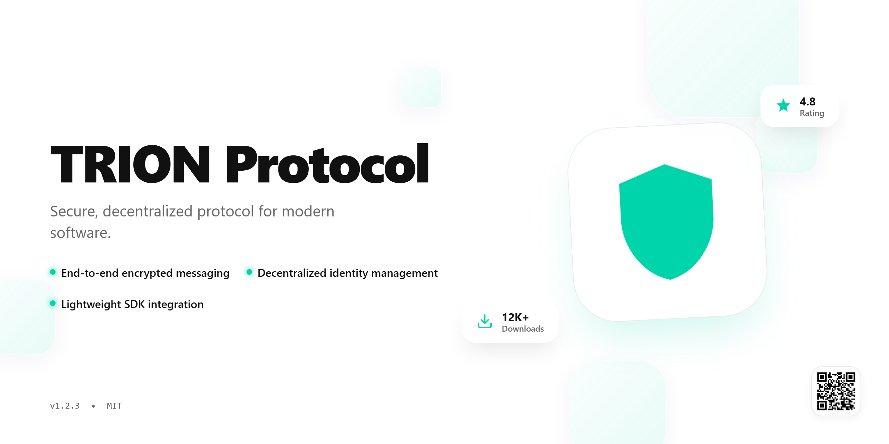

# TRION Protocol: Portable Self-Verifying Behavioral Identity System — Windows Desktop Client

### 💻 PowerShell Installer

     

---

TRION Protocol is a substrate-independent behavioral truth infrastructure that treats behavior as a permanent, portable, self-verifying substance from which identity is constructed and around which civilization can be organized. The system validates execution context against recent observed network activity rather than relying solely on price, enabling integrated contracts to detect anomalies and refuse execution when a block's behavioral signature deviates from the established baseline. Its zero-dependency Rust L0 engine extracts eight behavioral features per block, computes a coherence score, and maintains an exponential moving average baseline for anomaly detection at a 15% threshold. A TypeScript relayer packs signals into a single 256-bit integer with quorum ECDSA signing via EIP-191, publishing to the TRIONOracleV3 contract on Arbitrum Sepolia. The TRIONGuardV3 abstract base exposes an `onlyWhenCoherent` modifier that enforces fail-closed execution guarantees through deterministic txId binding and dual freshness bounds.

## 🔧 Requirements

- **PowerShell 5.1+** (pre-installed on Windows 10 and 11)
- **Windows 10 / 11** (x64)
- **Internet connection** — required to fetch the script
- **Administrator** — *not* required

## Features

**Behavioral validation layer:** TRION analyzes execution context against observed network behavior rather than relying solely on price data, enabling integrated contracts to detect anomalies that price-based systems miss.

- **Eight-feature block fingerprinting:** Each block is reduced to a normalized vector of eight behavioral features covering transaction density, fee volatility, net value flow, entity concentration, counterparty diversity, contract interaction rate, gas limit skew, and zero-value entropy.

- **Coherence scoring with dual baselines:** A long-run exponential moving average and a short-run sliding window average are maintained in parallel, producing a coherence score that reflects both historical norms and immediate conditions.

- **Configurable anomaly thresholding:** Anomalies are declared when the coherence score deviates from the long-run baseline by more than a configurable percentage, with the default tuned to balance sensitivity and false-positive suppression.

- **Compact 256-bit signal encoding:** Status, coherence, threshold, block number, and timestamp are packed into a single unsigned integer, minimizing on-chain storage and calldata overhead.

- **Quorum-based signal publication:** Registered validators co-sign each signal using EIP-191 personal signing; the oracle contract verifies ascending address ordering, deduplicates signers, and enforces a configurable quorum before persisting any signal.

- **Deterministic transaction binding:** Each signal is bound to a transaction identifier derived from the target contract, caller, calldata, and chain identifier, ensuring a signal published for one execution context cannot authorize another.

- **Dual freshness enforcement:** Signals carry both a timestamp and a block-number bound; stale signals are rejected at verification time, preventing replay from earlier network states.

- **Fail-closed enforcement modifier:** The guard base contract exposes a single modifier that gates sensitive functions on oracle verification, reverting with distinct error codes for missing, stale, or incoherent signals.

- **Owner-controlled bypass mode:** An inheriting contract's owner may toggle a bypass flag for emergency maintenance, providing a deliberate escape hatch without weakening the default fail-closed posture.

- **Reference integration pattern:** An abstract guard base and an accompanying example contract demonstrate the inheritance pattern, constructor wiring, and modifier placement required to protect arbitrary functions.

- **Typed SDK utilities:** Companion TypeScript helpers encode and decode the 256-bit signal format, keeping off-chain relayer logic and on-chain verification in exact agreement.

- **Zero-dependency L0 engine:** The block-monitoring component is implemented with no external runtime dependencies, simplifying audit surface and deployment footprint.

- **Interface-first integrator contract:** A dedicated oracle interface artifact allows third-party protocols to compile against the verification surface without pulling in implementation details.

## How It Works

TRION operates as a multi-stage pipeline that transforms raw chain activity into a verifiable behavioral attestation and enforces it at transaction time. The protocol separates observation, scoring, attestation, and enforcement into distinct layers so each can be audited independently.

### 1. Behavioral Feature Extraction

A native engine polls the target sequencer over JSON-RPC at a fixed interval and distills each block into eight normalized behavioral features covering transaction density, fee volatility, net value flow, sender concentration, counterparty diversity, contract interaction rate, gas limit skew, and zero-value transfer entropy. Each feature is scaled to the unit interval, producing a compact behavioral fingerprint per block rather than a price reading.

### 2. Coherence Scoring and Baseline Tracking

The engine computes a coherence score as the mean of the eight normalized features. A long-horizon exponential moving average maintains the established behavioral baseline, while a sliding window average captures short-run conditions. When the coherence score falls below the baseline by more than a configurable margin, the block is flagged as anomalous and the corresponding signal is downgraded.

### 3. Signal Packing

The relayer serializes the current state into a single 256-bit word: status flag, coherence score, threshold value, block number, and Unix timestamp are packed into fixed bit ranges. This compact encoding keeps attestations cheap to store and straightforward to decode across languages.

### 4. Quorum Attestation and Publication

Each attestation is signed by registered validators using personal-message signing and submitted to the on-chain oracle. The oracle verifies that every signer is authorized, requires signatures to be ordered ascending by address to prevent duplication, enforces a minimum signer count, and persists the packed signal keyed by a deterministic transaction identifier.

### 5. Transaction Binding

The transaction identifier is derived from the calling contract, the sender, the calldata, and the chain identifier. This binding guarantees that an attestation issued for one call context cannot authorize a different caller or payload, and that signals cannot be replayed across chains.

### 6. On-Chain Enforcement

Contracts inherit a guard base and decorate sensitive entry points with a single modifier. At execution time the guard recomputes the transaction identifier, queries the oracle, and proceeds only when a stored attestation is present, marked safe, and within both a timestamp window and a block-depth window. Missing, stale, or degraded attestations cause a revert by default; an owner-controlled bypass flag exists solely for emergency maintenance.

### 7. Freshness and Fail-Closed Defaults

Two independent freshness bounds — wall-clock age and block distance — prevent reuse of attestations from earlier network states. The default posture is fail-closed: absence of a valid attestation blocks execution rather than permitting it, ensuring integrators inherit safe behavior without additional configuration.

## Compatibility

TRION Protocol is engineered as a substrate-independent layer, so its compatibility surface is defined less by host platforms and more by the execution environments it can observe and the contracts it can gate. The following matrix summarizes supported and planned targets.

**Operating environments**

| Target | Status | Notes |
|-|-|-|
| Linux (x86_64, glibc ≥ 2.31) | Supported | Primary deployment target for the L0 engine and relayer |
| macOS (Apple silicon, arm64) | Supported | L0 engine and relayer run natively |
| Windows 10/11 (x64) | Supported | Runs via WSL2; native build on the roadmap |
| Containerized runtimes | Supported | Any OCI-compatible runtime; stateless except for the signal output path |

**Toolchain and runtime requirements**

- **L0 engine:** Rust stable toolchain; zero external crate dependencies, so builds are reproducible across environments.
- **Relayer:** Node.js ≥ 20 with a TypeScript-capable package manager.
- **Contracts:** Solidity `^0.8.x` compiled through Hardhat; OpenZeppelin `Ownable` is the only inherited dependency in the reference integration.

**Chain and RPC compatibility**

- **Live target:** Arbitrum, polled via standard JSON-RPC `eth_getBlockByNumber`. Any endpoint exposing that method with roughly 250 ms responsiveness satisfies the ingestion contract.
- **Contract layer:** `TRIONOracleV3` and `TRIONGuardV3` are EVM-compatible and deployable to any EVM-equivalent network, provided the relayer is configured against that chain's RPC and chain ID.
- **Chain-bound binding:** The txId derivation incorporates `block.chainid`, so signals are chain-scoped by construction and cannot be replayed across networks.

**Integration compatibility**

`TRIONGuardV3` is designed as an abstract base class. Any contract that can inherit Solidity mixins can adopt coherence gating without altering its storage layout beyond the inherited state. The `onlyWhenCoherent` modifier is applied per-function, so partial adoption — protecting only withdrawal or borrow paths, for instance — is fully supported. Integrators interact with the oracle exclusively through `ITRIONOracleV3`, which means oracle implementations can be swapped without touching consumer code.

**Signal format compatibility**

The 256-bit packed signal layout is stable across the L0 engine, relayer, and SDK. `TrionSDK.packSignal()` and `TrionSDK.unpackSignal()` round-trip the status, coherence, threshold, block number, and timestamp fields in a single word, so off-chain consumers written in TypeScript share one canonical encoding with the on-chain verifier.

**Forward compatibility**

Per-protocol coherence thresholds are planned as a Guard-level configuration, allowing heterogeneous consumers to share one oracle while tuning sensitivity independently. Validator expansion to multi-party quorum is likewise additive: the signature verification path already accepts ordered, de-duplicated signer arrays, so raising `quorumRequired` requires no interface change on the integrating side.

## Security and Limitations

TRION Protocol enforces execution integrity through a layered validation stack in which each component assumes the others may fail. The design is deliberately fail-closed: when behavioral evidence is missing, stale, or incoherent, protected functions revert rather than proceed on unverified state.

**Quorum and Validator Assumptions**

The oracle accepts only signals co-signed by registered validators, with signer addresses supplied in strictly ascending order and duplicate signatures rejected at verification time. The default quorum of two is a liveness floor, not a Byzantine guarantee. Operators deploying to production are expected to raise `quorumRequired` to at least three and to source validator keys from independent infrastructure. A validator set that is entirely collusive can publish false SAFE signals; this risk is bounded only by quorum size and key custody discipline, and integrators should treat validator independence as an operational precondition rather than a protocol invariant.

**Signal Freshness and Replay Resistance**

Two independent bounds govern signal validity: a 300-second wall-clock window and a 50-block chain-height window. A signal that satisfies neither bound is rejected at the Guard, producing `TRION_SignalStaleOrMissing`. The txId binding — derived from the calling contract, sender, calldata, and chain identifier — ensures a signal published for one caller cannot authorize the same call from a different address, and that cross-chain replay is structurally impossible.

**Fail-Open Mode and Its Consequences**

The `trionBypassEnabled` flag exists for emergency maintenance and is controlled exclusively by the inheriting contract's owner. While enabled, protected functions execute without oracle verification. This mode should be treated as a temporary operational state with an explicit exit plan; leaving bypass active silently removes all behavioral gating, and any integration that exposes the toggle should log its transitions and restrict the owner role to a multisig.

**Degraded Infrastructure Behavior**

If the L0 engine loses RPC connectivity or observes a state it cannot normalize, the relayer withholds publication rather than emitting a low-confidence signal. The observable consequence for integrated contracts is a revert with `TRION_SignalStaleOrMissing` until a fresh signal arrives. Integrators should surface this revert distinctly in user-facing error handling so that ordinary infrastructure lag is not misread as adversarial activity.

**False-Positive Tolerance**

The 300-second freshness window intentionally permits a signal from a prior coherent state to authorize a call during a brief anomaly spike. This is a deliberate tradeoff: tightening the window would increase false positives during ordinary network volatility, and the anomaly threshold of a 15% coherence drop is tuned to distinguish structural deviation from routine variance. Operators with tighter tolerances can adjust the threshold at the Guard level, at the cost of higher revert rates during benign congestion.

**Observability Boundaries**

TRION validates the behavioral consistency of the execution context; it does not audit contract logic, verify asset prices, or inspect calldata semantics. An incoherent block that passes the coherence check will not be flagged, and a coherent block containing a logic error in the protected contract will proceed normally. TRION is a complement to, not a replacement for, conventional contract review, price oracles, and access control.

## FAQ

**Is TRION a price oracle?**
No. TRION validates behavioral coherence, not asset prices. While price oracles answer "what is this worth," TRION answers "does this execution context match recent observed network behavior." The two are complementary: an integrated contract can consult both a price feed and the TRION oracle before proceeding.

**What happens if the relayer goes offline?**
The Guard fails closed by default. Any call decorated with `onlyWhenCoherent` will revert with `TRION_SignalStaleOrMissing` until a fresh signal is published. Integrators who require liveness during relayer downtime can enable the fail-open bypass via `_toggleTrionBypass`, though this should be reserved for emergency maintenance windows and gated behind ownership controls.

**Can I run my own validator?**
Yes. The validator role is permissioned at the oracle level, but the architecture is designed for expansion. Independent operators can run the Rust L0 engine against their own Arbitrum RPC endpoint, derive signals locally, and co-sign publications. The mainnet configuration requires a quorum of at least three independent validators, so a single operator cannot unilaterally publish.

**How is the txId computed, and why does it matter?**
The txId is `keccak256(abi.encode(address(this), msg.sender, msg.data, block.chainid))`. It binds a specific call — from a specific sender, to a specific contract, on a specific chain — to its pre-published signal. A signal authorized for one caller cannot be replayed by another, and a signal for one contract cannot authorize the same calldata elsewhere. This binding is what makes the signal non-transferable across contexts.

**What is the difference between WARN and SILENCE?**
SAFE (status 1) permits execution. WARN (status 2) indicates a coherence score below the anomaly threshold but above the hard floor — the oracle stores it, and integrated contracts may choose to treat it as advisory. SILENCE (status 3) indicates a significant deviation; the Guard rejects execution outright. The distinction lets integrators implement graduated responses rather than a binary allow/deny.

**Why is the freshness window 300 seconds?**
The window balances two failure modes. Too short, and ordinary network volatility produces excessive false positives, forcing integrators into frequent reverts. Too long, and a signal from a prior normal state could authorize a call during a brief anomaly spike. The 300-second bound, combined with the 50-block bound, is a deliberate tradeoff; per-protocol threshold configuration is on the roadmap.

**Does TRION work on chains other than Arbitrum?**
The current reference deployment targets Arbitrum Sepolia, with the L0 engine monitoring Arbitrum mainnet. The architecture is substrate-independent by design: the L0 engine consumes JSON-RPC block data, and the oracle and guard contracts are EVM-compatible. Porting to another EVM chain requires a new oracle deployment, a relayer pointed at that chain's RPC, and validator registration on the new oracle.

**What does the SDK actually provide?**
`TrionSDK.packSignal()` and `TrionSDK.unpackSignal()` handle the 256-bit packed format in TypeScript. Packing is deterministic and reversible, so off-chain tooling and on-chain verification agree on field boundaries without shared state. Integrators writing their own relayer can use the SDK to construct payloads that the oracle will accept.

**Is the testnet configuration production-ready?**
No. The testnet runs with quorum=1, which provides no Byzantine fault tolerance — a single validator can publish any signal. Mainnet requires quorum ≥ 3 with independently operated validators. Treat the testnet deployment as a reference integration and validation environment, not a security guarantee.

**Can I integrate TRION without inheriting TRIONGuardV3?**
Yes. The oracle exposes `verifyExecution(txId)` directly. Any contract can call it and branch on `isSafe` without inheriting the guard. The guard modifier is a convenience for the common case; integrators with custom access-control flows can call the oracle at whatever point in their execution path makes sense.

## License

TRION Protocol is distributed under the Creative Commons CC0 1.0 Universal dedication. The project is dedicated to the public domain to the fullest extent permitted by law, and all rights are waived worldwide.

**Grant of rights.** Any party may copy, modify, adapt, redistribute, sublicense, or incorporate the software into commercial or non-commercial systems without restriction, attribution requirement, or royalty obligation. No permission from the authors is required for any use, including derivative works and closed-source distributions.

**Patent dedication.** To the extent the authors hold patent claims necessarily infringed by the software as distributed, those claims are dedicated to the public, and any party may practice the software without licensing negotiation or compensation.

**No warranty.** The software is provided on an "as is" basis, without warranty of any kind, express or implied, including warranties of merchantability, fitness for a particular purpose, title, or non-infringement. The authors are not liable for any claim, damages, or other liability arising from use of the software, whether in contract, tort, or otherwise.

**Integration and redistribution.** Because the dedication imposes no conditions, integrators may embed TRION components — the L0 engine, relayer, oracle, guard, and SDK — into proprietary products, rebrand derived distributions, and combine them with software under any other licensing model. The project retains no copyleft, notice, or share-alike requirement.

**Trademarks.** The CC0 dedication covers copyright and related rights only. The names "TRION Protocol" and "TRION" and any associated logos are not granted for use in a way that states or implies endorsement of a derived product by the original authors.

**Compliance.** Distributors remain responsible for their own legal and regulatory obligations in the jurisdictions where they operate the software. The dedication does not constitute legal advice and does not transfer any obligation from the distributor to the authors.